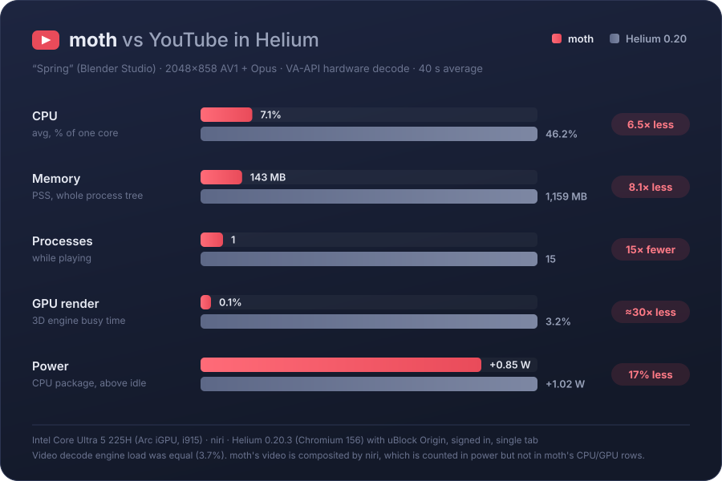

# moth (POC)

A native YouTube desktop client.

Linux + Wayland only. UI in [gpui](https://gpui.rs) (Vulkan via wgpu); video via GStreamer, with
`waylandsink` attaching a `wl_subsurface` to the gpui window so hardware-decoded frames (VA-API
dmabufs) go straight to the compositor.

## Performance



Same video, codec and resolution in both, hardware-decoded via VA-API, averaged over 40 s of playback.
CPU, memory and GPU are measured over each app's whole process tree; power is the CPU package's
draw above idle (RAPL), which is noisy to about ±0.2 W. moth still uses mock data, so it doesn't yet
pay for loading a real watch page the way the browser does.

## Setup (Arch)

```sh
sudo pacman -S rustup gst-plugins-good gst-plugins-bad gst-plugins-bad-libs gst-plugin-va \
  gst-plugin-pipewire gst-libav yt-dlp deno intel-media-driver vulkan-intel \
  wayland libxkbcommon fontconfig freetype2 cmake clang
rustup default stable
./scripts/fetch-vendor.sh      # clones gpui (Zed) at the pinned rev + applies patches/
cargo run --release
```

Paste a YouTube link (watch, youtu.be, shorts, … or a bare video ID) into the address bar and press
Enter to open it. `Ctrl+L` focuses the address bar.

`MOTH_OPEN=<home card index | YouTube URL | video ID>` opens that video at startup (dev aid).

## Open YouTube links in moth (browser extension)

`extension/` is a Chromium extension (Helium, Chrome, Chromium, Brave, Vivaldi, Edge) that sends
YouTube watch links to moth instead of playing them in the browser. If moth is already running, the
video switches there; otherwise moth starts. Embedded players are left alone.

1. Build moth: `cargo build --release`
2. Register moth with your browsers: `extension/install-native-host.sh` (writes
   `NativeMessagingHosts/dev.moth.open.json` into each browser's config directory; pass a path to use
   a different moth binary, `--uninstall` to remove)
3. In the browser, open the extensions page, enable *Developer mode*, choose *Load unpacked* and
   select the `extension/` folder.

Clicking the toolbar icon turns the redirect off and on. If moth can't be reached, the page offers
to watch in the browser instead.

How it works: full page loads of `youtube.com/watch` (and `youtu.be` links, which redirect there)
are redirected by a declarativeNetRequest rule to the extension's handoff page; YouTube's in-page
navigation is caught via `webNavigation.onHistoryStateUpdated`. Either way the URL goes to moth
through native messaging: the browser runs `moth chrome-extension://…`, which forwards the URL to
the running instance over `$XDG_RUNTIME_DIR/moth.sock` or starts a new one. `moth <url>` from a
shell works the same way.

Wayland doesn't let an app take focus without a token from a user action, so a running moth is
marked as wanting attention rather than raised.

## How YouTube is accessed

- Video details, related videos and stream URLs come from [RustyPipe](https://codeberg.org/ThetaDev/rustypipe)
  (YouTube's internal API), in-process.
- Streams are fetched by moth itself in bounded byte ranges (YouTube's CDN rejects un-ranged requests) and fed
  to GStreamer through an `appsrc`.
- RustyPipe currently gets streams from YouTube's iOS client, whose URLs only serve a little ahead of real-time
  playback. So yt-dlp resolves web-client URLs for the *same* files in the background, and the player switches to
  them when a seek needs it. yt-dlp is also the full fallback if RustyPipe fails.

Keys on the watch page (when the address bar isn't focused): `space`/`k` play-pause, `j`/`l` ±10s, `←`/`→` ±5s, `f` (or double-click the video) fullscreen, `esc` leave fullscreen.

## Layout

- `src/main.rs`: gpui views (home grid, watch page) and the video canvas that positions the subsurface
- `src/youtube.rs`: RustyPipe client (video details, related videos, stream selection, URL resolving)
- `src/player.rs`: GStreamer pipeline (ranged `appsrc` → `decodebin3` → `waylandsink` / `pipewiresink`) and the yt-dlp resolver
- `src/text_input.rs`: the address bar (adapted from gpui's input example)
- `src/ipc.rs`: single-instance handoff (`moth <url>`) and the browser extension's native-messaging host
- `extension/`: the "Open in moth" browser extension and its native-host installer
- `src/data.rs`: hardcoded mock data
- `patches/`: local patches to vendored gpui (currently: Vulkan-only wgpu backend)
