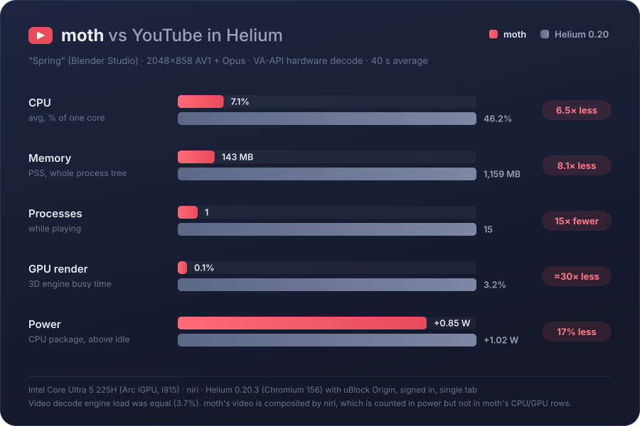

# moth

A fast, native YouTube client for the Linux desktop.

moth plays YouTube without a browser: a GPU-rendered [gpui](https://gpui.rs) interface, video decoded in
hardware by GStreamer and handed straight to the Wayland compositor. It uses a fraction of the CPU, memory and
power of watching in a browser tab, and it fits into the desktop: media keys, MPRIS, a status CLI for bars and
a browser extension that sends YouTube links to it.

> **Status:** early and under active development. Watching videos works well; the home page shows YouTube's
> recommendations (yours, once a recommendation account is signed in), and there are no subscriptions or
> search yet. Linux + Wayland only.

## Features

- **Hardware-accelerated playback.** VA-API decoding (VP9, AV1, H.264) with zero-copy dmabufs: decoded frames
  go to the compositor through a Wayland subsurface, and moth never touches video pixels.
- **Quality and playback controls.** Resolution and codec selection (automatic or manual), audio tracks
  (dubs), playback speed from 0.25× to 2×, fullscreen.
- **Paste anything.** Watch, `youtu.be` and Shorts links or bare video IDs in the address bar (links with a
  timestamp start there); video details, description and related videos on the watch page.
- **Desktop integration.** An MPRIS player for media keys, shells and `playerctl`; `moth status [--watch]`
  for status bars; single-instance handoff, so `moth <url>` opens the link in the running window.
- **Browser handoff.** A Chromium extension that opens YouTube links in moth instead of the browser.
- **Fluid UI.** Layout changes animate on springs instead of jumping, rendered with Vulkan.
- **Light on resources.** While the window is out of sight (another workspace, scrolled away, covered), moth
  stops downloading and decoding video and only plays the audio; the picture catches up when you look again.
- **YouTube Music.** A Music tab with your YouTube Music home (signed out, the popular one), and a now-playing
  bar on every page: queues from a song's radio or a playlist that keep going, previous/next, seeking, shuffle,
  repeat, like/dislike, and an expanded player with the queue and a Song/Video switch. Songs play as audio
  alone (no video downloaded or decoded) unless you pick Video.
- **Accounts.** A recommendation account for your own home feed, and a playback account for videos that need
  you signed in, each signed in with a code at google.com/device or a browser session; kept in your keyring.
- **Your defaults.** Preferred resolution and codecs, default speed, seek steps, animations and more are
  settings, not hardcoded choices.

## Performance



Same video, codec and resolution in both, hardware-decoded via VA-API, averaged over 40 s of playback.
CPU, memory and GPU are measured over each app's whole process tree; power is the CPU package's
draw above idle (RAPL), which is noisy to about ±0.2 W. The benchmark predates real watch pages in moth,
so moth didn't yet pay for loading one the way the browser does.

## Installation

moth isn't packaged yet; build it from source. On Arch Linux:

```sh
sudo pacman -S rustup gst-plugins-good gst-plugins-bad gst-plugins-bad-libs gst-plugin-va \
  pipewire-pulse gst-libav yt-dlp deno intel-media-driver vulkan-intel \
  wayland libxkbcommon fontconfig freetype2 cmake clang
rustup default stable
git clone https://github.com/sortedcord/moth && cd moth
./scripts/fetch-vendor.sh      # clones gpui (Zed) at the pinned revision and applies patches/
cargo build --release
./target/release/moth
```

Requirements: a Wayland compositor, Vulkan, and PipeWire (with `pipewire-pulse`) or PulseAudio for audio. `intel-media-driver` and `vulkan-intel` are
for Intel GPUs; use your GPU's VA-API driver and Vulkan driver instead (e.g. `libva-mesa-driver` and
`vulkan-radeon` on AMD). yt-dlp (with deno for YouTube's JavaScript challenges) is used as a fallback resolver.

## Usage

Paste a YouTube link (watch, `youtu.be`, Shorts, … or a bare video ID) into the address bar and press Enter.
`moth <url>` from a shell does the same, in the running window if there is one.

| Key | Action |
|---|---|
| `Ctrl+L` | Focus the address bar |
| `Ctrl+,` | Settings |
| `space` / `k` | Play / pause |
| `j` / `l` | Back / forward 10 s (adjustable in settings) |
| `←` / `→` | Back / forward 5 s (adjustable in settings) |
| `f`, or double-click the video | Fullscreen |
| `Esc` | Leave fullscreen |

Watch-page keys apply when the address bar isn't focused. The gear button under the video has quality, codec,
audio track and speed. Settings are saved to `~/.config/moth/settings.json`.

### Open YouTube links in moth (browser extension)

`extension/` is a Chromium extension (Helium, Chrome, Chromium, Brave, Vivaldi, Edge) that sends
YouTube watch links to moth instead of playing them in the browser. If moth is already running, the
video switches there; otherwise moth starts. Embedded players are left alone.

1. Build moth: `cargo build --release`
2. Register moth with your browsers: `extension/install-native-host.sh` (writes
   `NativeMessagingHosts/dev.moth.open.json` into each browser's config directory; pass a path to use
   a different moth binary, `--uninstall` to remove)
3. In the browser, open the extensions page, enable *Developer mode*, choose *Load unpacked* and
   select the `extension/` folder.

The toolbar icon opens a popup with a switch that turns the redirect off and on. If moth can't be
reached, the page offers to watch in the browser instead.

The popup can also **share the browser's YouTube account** with moth: *Share as recommendation account* or
*Share as playback account* sends the browser's youtube.com session (its cookies, read with the `cookies`
permission) to the running moth, which signs that account in and shows the result in its settings. YouTube
rotates a session's cookies now and then, and a session used in two places can occasionally sign one of
them out; signing in with a code (Settings → YouTube accounts) avoids that. After updating the extension,
reload it on the extensions page; it asks for the new permission.

How it works: full page loads of `youtube.com/watch` (and `youtu.be` links, which redirect there)
are redirected by a declarativeNetRequest rule to the extension's handoff page; YouTube's in-page
navigation is caught via `webNavigation.onHistoryStateUpdated`. Either way the URL goes to moth
through native messaging: the browser runs `moth chrome-extension://…`, which forwards the URL to
the running instance over `$XDG_RUNTIME_DIR/moth.sock` or starts a new one.

Wayland doesn't let an app take focus without a token from a user action, so a running moth is
marked as wanting attention rather than raised.

### Status and remote control

**`moth status`** prints what the running instance is doing as one JSON line; **`moth status --watch`** prints it
again on every change (position in whole seconds, so about once a second while playing) and is meant for status
bars. Without a running moth it prints `{"running":false,…}`; `--watch` then waits for one to start.

```json
{"running":true,"page":"watch","status":"playing","error":null,
 "video":{"source":"youtube","id":"aqz-KE-bpKQ","url":"https://www.youtube.com/watch?v=aqz-KE-bpKQ",
          "title":"Big Buck Bunny 60fps 4K - Official Blender Foundation Short Film","channel":"Blender",
          "thumbnail":"https://i.ytimg.com/vi/aqz-KE-bpKQ/hqdefault.jpg"},
 "position":12.78,"duration":634.0,"rate":1.0,
 "stream":{"width":1280,"height":720,"fps":60.0,"quality":"720p60","quality_auto":true,
           "video_codec":"VP9","audio_codec":"Opus","audio_track":null,"decoder":"vavp9dec","resolver":"rustypipe",
           "fallback_urls":false,"video_suspended":false},
 "fullscreen":false,"queue":null}
```

`status` is one of `idle`, `resolving`, `buffering`, `playing`, `paused`, `ended`, `error`; `page` is `home`, `music`,
`watch` or `settings`. `video_suspended` is true while video is off because the window is out of sight. `queue` is set while music plays:
`has_next`, `has_previous`, `shuffle` and `repeat` (`off`, `all`, `one`); MPRIS next/previous move through it.
`audio_track` names the audio track
(e.g. `"German"`) for videos with several, such as dubs. Title and channel are `null` until the watch page has loaded. Under the hood this is the
`$XDG_RUNTIME_DIR/moth.sock` socket: send the line `status` or `watch` (a URL line opens that video).

moth is also an **MPRIS** player (`org.mpris.MediaPlayer2.moth`), so media keys, desktop shells and `playerctl`
work: play/pause/stop (stop closes the video), seek, set position, rate (0.25–2×), open URI, raise and quit.
Metadata has the title, channel (`xesam:artist`), thumbnail, URL and length, plus `moth:resolution`,
`moth:fps`, `moth:quality` and `moth:videoCodec`.

## How it works

**YouTube access.**
- Video details and related videos come from [RustyPipe](https://codeberg.org/ThetaDev/rustypipe) (YouTube's
  internal API), in-process.
- Stream URLs come from YouTube's visionOS client, which moth asks directly over the same API. Its URLs are
  plain (nothing to decipher, no PO token) and serve any part of the file straight away, so a far seek is a
  single range request, as in a browser: about half a second until it plays again.
- Streams are fetched by moth itself in bounded byte ranges (YouTube's CDN rejects un-ranged requests) and fed
  to GStreamer through an `appsrc`.
- If the visionOS client gives no streams, RustyPipe gets them from YouTube's iOS client instead. Those URLs only
  serve a little ahead of real-time playback, so [yt-dlp](https://github.com/yt-dlp/yt-dlp) resolves web-client
  URLs for the *same* files in the background, and the player switches to them when a seek needs it. yt-dlp is
  also the last resort. YouTube sometimes holds yt-dlp's URLs back for a few seconds (the slot of an ad before
  the video); moth waits that out, so on this path a far seek right after opening a video can take a while.
- Videos YouTube only plays to a signed-in viewer (age-restricted, members-only) go through the playback
  account: yt-dlp, signed in with its browser session's cookies (from a temporary private file). A playback
  account signed in with a code can't play those yet: the TV app only gets SABR streams for them (#11), as
  do Premium's higher-bitrate formats.
- The recommendation account's home feed comes from the TV app (code sign-in) or the web (browser session);
  while a video plays, moth reports progress to its watch history the way YouTube's apps do.

**Playback.** A GStreamer pipeline: ranged `appsrc` → `decodebin3` → `waylandsink` for video and → `scaletempo`
→ `pulsesink` for audio. `waylandsink` shares gpui's Wayland connection and attaches a `wl_subsurface` to the
window, positioned wherever the UI lays out the player. The audio sink is the pipeline's clock and video follows
it, so audio is never edited to match another clock (that's what caused pops and crackling). It's `pulsesink`
(served by pipewire-pulse) because `pipewiresink`'s clock jumps when an idle device wakes up, which made resuming
after a pause skip ahead.

**Hidden windows.** niri (and some other compositors) never tell a window on another workspace that it's hidden,
but they all stop granting it frames, so moth times how long a frame takes, as mpv does. Once the window has been
out of sight for a moment, the video source stops fetching, so the video branch runs dry and decodes nothing,
while audio plays on. Coming back, the source carries on from the keyframe before the current position (found
in the stream's own index: an MP4 `sidx` or WebM cues), without a seek, so audio isn't interrupted.

**UI.** [gpui](https://gpui.rs), Zed's GPU-accelerated UI framework, rendering through wgpu on Vulkan. It's
vendored at a pinned revision with a small local patch (`patches/`).

## Development

See [CONTRIBUTING.md](CONTRIBUTING.md) for setup, the architecture, debug tools and conventions. Source layout:

- `src/backend/`: everything that isn't UI, and nothing that depends on gpui
  - `source.rs`: the `VideoSource` trait a site implements; `youtube/` is the only site so far (RustyPipe, the
    visionOS client for streams, yt-dlp as fallback and for seekable alternate URLs), and `local.rs` plays pre-downloaded videos for
    development (`scripts/fetch-dev-media.sh`)
  - `media.rs`, `selection.rs`: the site-neutral model (videos, streams, codecs) and stream selection
  - `player/`: the GStreamer pipeline, the ranged HTTP source and the Wayland embedding
- `src/ui/`: the gpui frontend: `mod.rs` (window, navigation, top bar), `playback.rs` (the playback session),
  `watch/`, `home.rs` + `layout.rs` (spring-animated grid), `settings_page.rs`, `actions.rs` (keyboard shortcuts)
- `src/desktop/`: the instance socket and `moth status`, MPRIS, and the browser extension's native host
- `src/settings.rs`: persisted settings; `src/dev.rs`: `MOTH_*` developer options
- `extension/`: the "Open in moth" browser extension and its native-host installer
- `patches/`: local patches to vendored gpui (currently: Vulkan-only wgpu backend)

## Credits

moth is built on the work of many projects:

- [gpui](https://gpui.rs) from [Zed](https://zed.dev) (Apache-2.0): the UI framework. `src/ui/text_input.rs` is
  adapted from gpui's text input example.
- [RustyPipe](https://codeberg.org/ThetaDev/rustypipe) by ThetaDev (GPL-3.0): YouTube's internal API.
- [yt-dlp](https://github.com/yt-dlp/yt-dlp) (Unlicense), with [Deno](https://deno.com) (MIT): fallback and
  seek-ahead stream resolving.
- [GStreamer](https://gstreamer.freedesktop.org) (LGPL-2.1-or-later) and its
  [Rust bindings](https://gitlab.freedesktop.org/gstreamer/gstreamer-rs) (MIT/Apache-2.0): media playback.
- [PipeWire](https://pipewire.org) (MIT): audio output.
- [wgpu](https://wgpu.rs) (MIT/Apache-2.0) and [Taffy](https://github.com/DioxusLabs/taffy) (MIT), via gpui:
  rendering and layout.
- [zbus](https://github.com/z-galaxy/zbus) (MIT): D-Bus, for MPRIS.
- [Tokio](https://tokio.rs) (MIT), [reqwest](https://github.com/seanmonstar/reqwest) (MIT/Apache-2.0),
  [Serde](https://serde.rs) (MIT/Apache-2.0) and the rest of the Rust crates in `Cargo.lock`.
- [Outfit](https://github.com/Outfitio/Outfit-Fonts) by the Outfit Project Authors (SIL Open Font License 1.1):
  the UI font, bundled in `assets/fonts/` with its license.

moth is an independent project, not affiliated with or endorsed by YouTube or Google.

## License

moth is free software, licensed under the [GNU General Public License v3.0](LICENSE). Contributions are welcome:
see [CONTRIBUTING.md](CONTRIBUTING.md) and the [Code of Conduct](CODE_OF_CONDUCT.md).
